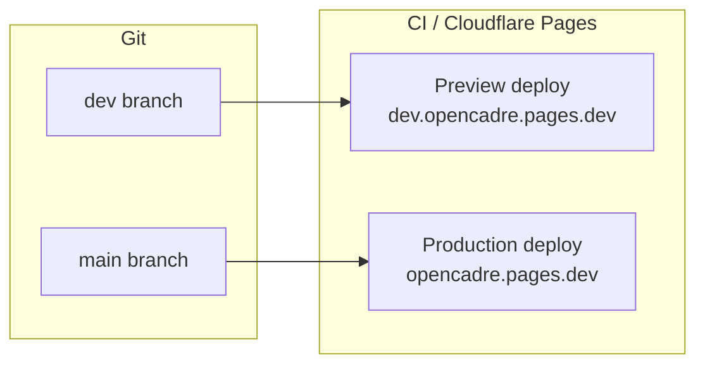

# OpenCadre — Project Tracking

This document describes the Git workflow, commit conventions, project history,
changelog, and roadmap for OpenCadre.

## 1. Git workflow

### Branches

| Branch | Purpose | Deployment |
| --- | --- | --- |
| `main` | Production-ready code | Cloudflare Pages production (https://opencadre.pages.dev) |
| `dev` | Active development | Cloudflare Pages preview (https://dev.opencadre.pages.dev) |

### Workflow

```text
1. Branch from dev:
   git checkout dev && git pull && git checkout -b feat/xyz

2. Work, commit (conventional commits), push.

3. Merge into dev when ready (or open a PR on GitHub).

4. When dev is stable and ready for production:
   git checkout main && git merge dev && git push
   (this triggers the production deploy)
```

The `dev` branch is the default development target. Feature branches merge
into `dev` first; `main` receives merges only when a release is ready for
production.

### Hooks and gates

- **pre-commit:** `.husky/pre-commit` runs `pnpm exec lint-staged`, which checks
  staged files with Biome.
- **commit-msg:** `.husky/commit-msg` runs `pnpm exec commitlint --edit "$1"` to
  validate the message against Conventional Commits.
- **pre-push:** `.husky/pre-push` runs
  `pnpm lint:full && pnpm test:run && pnpm typecheck && pnpm build && pnpm test:e2e`
  to ensure pushes are lint-clean, tested, typed, buildable, and browser-tested
  before leaving your machine. The E2E script starts local Supabase automatically
  (see [Playwright end-to-end tests](#playwright-end-to-end-tests)).

---

## 2. Commit conventions

The project follows the **Conventional Commits** specification
(https://www.conventionalcommits.org/):

```text
<type>[optional scope]: <description>

[optional body]

[optional footer(s)]
```

### Allowed types

| Type | Use when |
| --- | --- |
| `feat` | Adding a new user-facing feature |
| `fix` | Fixing a bug or incorrect behavior |
| `refactor` | Restructuring code without changing behavior |
| `chore` | Tooling, config, dependency updates |
| `docs` | Documentation-only changes |
| `style` | Formatting, no logic change |
| `test` | Adding or updating tests |
| `perf` | Performance improvement |
| `ci` | CI/CD pipeline changes |
| `build` | Build system changes |

### Examples

```text
feat(kanban): implement drag-and-drop card reordering
fix(auth): handle expired refresh tokens gracefully
refactor(realtime): extract reconcile guard into shared utility
chore: update Supabase SDK to v2.49
docs: add architecture and database documentation
```

---

## 3. Development commands

| Command | Purpose |
| --- | --- |
| `pnpm install` | Install dependencies |
| `pnpm dev` | Start local Vite dev server |
| `pnpm build` | Vite production build only |
| `pnpm typecheck` | TypeScript type checking only |
| `pnpm lint` | Biome lint |
| `pnpm lint:full` | Biome check (lint + format) |
| `pnpm format` | Biome format |
| `pnpm test:run` | Run Vitest unit tests (single run) |
| `pnpm test` | Start Vitest in watch mode |
| `pnpm test:e2e` | Run Playwright E2E tests (Chromium, Firefox, WebKit) |
| `pnpm test:e2e:ui` | Open Playwright UI mode for debugging |
| `pnpm deploy` | Build + deploy to Cloudflare Pages production |
| `make deploy-dev` | Build + deploy to Cloudflare Pages preview |

---

## 4. Supabase local development

The project includes a local Supabase stack for offline development:

```bash
pnpm supabase:start     # Start Docker-based local stack
pnpm supabase:stop      # Stop local stack
pnpm supabase:status    # Show local URLs and keys
```

The local stack mirrors the remote schema, seed data, and RLS policies. The
Makefile only contains `deploy-dev`; there are no `make supabase-*` targets.

### Playwright end-to-end tests

E2E specs live in `e2e/` and run with `pnpm test:e2e`, which starts local
Supabase first through `pnpm supabase:start`, so Docker must be available.
Playwright starts the Vite dev server through `webServer` in
`playwright.config.ts`, and `webServer.env` points the app at local Supabase
(`http://127.0.0.1:54321`) by default, overriding the remote URL in `.env`. Tests
run in Chromium, Firefox, and WebKit. Use `pnpm test:e2e:ui` for time-travel
debugging.

The authenticated journey test uses one seeded dev user per browser project
(`dev@opencadre.local`, `dev-firefox@opencadre.local`,
`dev-webkit@opencadre.local`, all with password `dev-password-123`). Separate
users keep first-time vault setup isolated across browsers. The device-link test
uses its own `dev-link@opencadre.local` user and runs only in the Chromium
project. Chromium onboards and creates a workspace, Firefox asks Chromium for a
link and unlocks after approval, then WebKit picks Firefox from the trusted
device list and unlocks after Firefox approves. Firefox and WebKit contexts set
explicit user agents because Playwright Test otherwise applies the Chromium
project's `Desktop Chrome` options to contexts created from manually launched
browsers, which gives every device the same label. The approval notifications in
this test travel over Supabase Realtime, so the local stack must run the image
versions pinned by the installed CLI. Containers created by an older CLI can keep
Realtime v2.120.3, which cannot register filtered `postgres_changes`
subscriptions against the newer `realtime.subscription` hash index and fails
with SQLSTATE `42P10`. Recreate them with `pnpm supabase stop` followed by
`pnpm supabase start` if approval dialogs never appear.

The stateful tests use a pool of 196 seeded accounts,
`e2e-005@opencadre.local` through `e2e-200@opencadre.local`, all with password
`dev-password-123`. `testAccount(testInfo, slot)` in `e2e/helpers.ts` assigns a
unique account to each test execution by combining its slot with a per-project
offset and a retry offset, so Chromium, Firefox, WebKit, and every retry attempt
never share a vault, device list, or workspace. Secondary users such as invitees
and removable members come from a separate band of the same pool through
`secondaryAccount`. With the six original tests plus fourteen new journeys, the
suite is 20 tests across three projects. The new
journeys cover sign-out, vault recovery and rejection, page management,
markdown editing, AI insertion, kanban fields and drag and drop, table editing
and CSV/bulk actions, shared tags and comments, invites, roles and removal,
settings, and concurrent editing. Only the AI edge function is mocked; all other
state goes through local Supabase. `e2e/global-setup.ts` runs
`pnpm exec supabase db reset` at the start of every `pnpm test:e2e` run, so a
previous run's registered devices cannot switch the gate to the device-link
panel. It skips the reset only when `SUPABASE_PUBLIC_URL` points away from local
Supabase. Run the suite with one command:

```bash
pnpm test:e2e
```

CI runs the same flow in the `e2e` job of `.github/workflows/ci.yml`: it starts
local Supabase, installs the three browsers, exports the local Supabase URL and
publishable key into `GITHUB_ENV`, builds the E2E bundle with
`vite build --mode e2e`, then runs `pnpm exec playwright test` against
`vite preview`. If you have `act` installed, you can exercise the same job
locally with `act -j e2e --pull=false`. The `--pull=false` flag reuses the cached
runner image instead of downloading it again. The medium runner image is
configured in `~/.config/act/actrc`.

---

## 5. Deployment pipeline



| Trigger | Action |
| --- | --- |
| Push to `dev` | Cloudflare Pages builds and publishes a preview deployment |
| Push to `main` | Cloudflare Pages builds and publishes a production deployment |
| PR merged to `dev` or `main` | Automatic rebuild |

Cloudflare Pages runs `pnpm build`, which is `vite build` only, and serves the
`dist/` output. GitHub Actions (`.github/workflows/ci.yml`) runs the `test` job
(typecheck, lint, unit tests, build) and the `e2e` job (Playwright against local
Supabase). The Husky pre-push hook provides a local gate with the same checks
plus E2E (`lint:full`, `test:run`, `typecheck`, `build`, `test:e2e`).

---

## 6. Project history

The project was initialized on **2026-07-24** and has been developed over
several focused development sessions.

### Key milestones

| Date | Milestone |
| --- | --- |
| 2026-07-24 | Project initialization: SolidJS + Supabase + vanilla-extract + Biome |
| 2026-07-24 | Basic Supabase connection established; env and config scaffolded |
| 2026-08-01 | Biome configured for Zed Editor; font setup (Geist, Vercetti) |
| 2026-09-10 | Pre-push hook and setup documentation added |
| 2026-09-10 | Edge functions migrated to `withSupabase` pattern |
| 2026-09-11 | Demo links added; responsiveness improvements |
| 2026-09-11 | Deploy script added (`pnpm deploy`) |
| 2026-11-04 | Release 1.7.0 |

### Commit statistics

- **Total commits (at `a9c5bef`, 2026-11-04):** 312
- **Commit range:** 2026-07-24 to 2026-11-04
- **Primary language:** TypeScript
- **Repository:** https://github.com/re1sub/opencadre

---

## 7. Roadmap

### Near-term (CCP evaluation closure)

| Phase | Items |
| --- | --- |
| Documentation | Requirements, architecture, API, database, project tracking (this doc) |
| Security | Output sanitization in Markdown editor, Content-Security-Policy headers, `.env.example` completeness |
| Error handling | Global `ErrorBoundary` for uncaught runtime errors |
| Component tests | SolidJS component unit tests (auth form, editable text, confirm dialog) |
| CI/CD | GitHub Actions pipeline for lint, typecheck, test, build, and E2E runs (present in `.github/workflows/ci.yml`); review deploy/preview automation as needed |

### Medium-term

| Item | Description |
| --- | --- |
| Markdown table editing | Native table block inside the TipTap editor |
| Search | Full-text search across workspace pages |
| Profile avatars | User-uploaded avatars in `profiles.avatar_url` |
| Shared display names | Make display names decryptable by teammates under the workspace key |
| Owner transfer | Transfer workspace ownership to another member |
| Export workspace | Full JSON/CSV export of workspace content |

### Long-term

| Item | Description |
| --- | --- |
| Real-time cursors | Show other users' cursors in collaborative editing |
| Multi-workspace subscriptions | Paid plans or usage limits per workspace |
| Mobile-optimized UI | Touch-optimized kanban and markdown editing |
| SSO / OAuth providers | Google, GitHub, or enterprise SSO sign-in |
| Audit log dashboard | Visual browser of `activity_logs` for workspace admins |